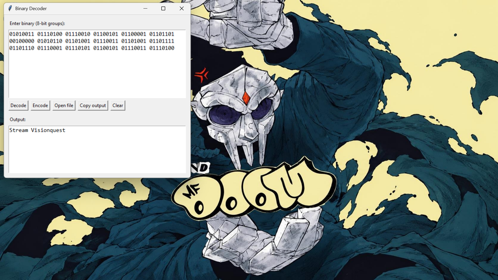

# binary-decoder-gui
A simple Python/Tkinter app that decodes binary into text. Built to practice Python and Git, and improved over time.

## Features
- Decode binary (8-bit groups) into text
- Encode text into binary
- Open a .txt file of binary and load it into the input boxhttps://github.com/Nathani21/binary-decoder-gui/pull/new/docs/readme-open-file
- Copy output, clear fields, and friendly error messages for invalid input

## How to run
1. Install [Python 3](https://www.python.org/downloads/). Tkinter comes with it on Windows.
2. Clone the repo:
```
   git clone https://github.com/Nathani21/binary-decoder-gui.git
   cd binary-decoder-gui
```
3. Start the app:
```
   python binary_decoder_gui.py
```

## Example
`01001000 01101001` decodes to `Hi`.



## Run tests
```
pip install pytest
python -m pytest
```