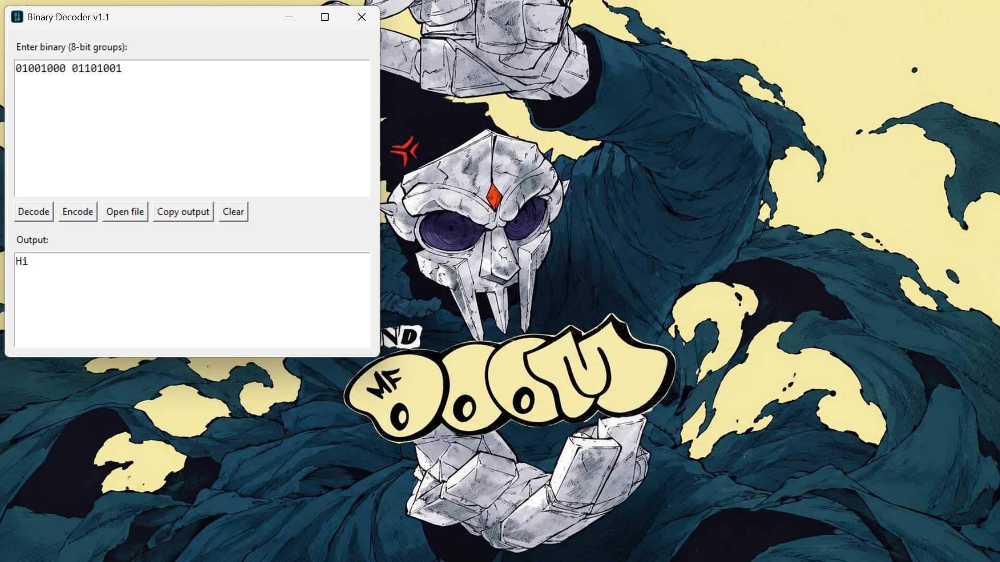

# binary-decoder-gui
A simple Python/Tkinter app that converts binary to text and text to binary. Built to practice Python and Git, and improved over time.


## Features
- Decode binary (8-bit groups) into text
- Encode text into binary
- Open a .txt file of binary and load it into the input box
- Copy output, clear fields, and friendly error messages for invalid input

## How to run
Windows users can skip Python: download `binary_decoder_gui.exe` from the [Releases page](https://github.com/Nathani21/binary-decoder-gui/releases).
1. Install [Python 3](https://www.python.org/downloads/). Tkinter comes with it on Windows.
2. Clone the repo:
```
   git clone https://github.com/Nathani21/binary-decoder-gui.git
   cd binary-decoder-gui
```
3. Start the app:
```
   python binary_decoder_gui.py
```

## Example
`01001000 01101001` decodes to `Hi`.



## How it works
Every character is stored as a number, and that number is written in binary using 8 bits (one byte). The letter `H` has the code 72, which is `01001000` in binary.

| Character | Code | Binary |
|---|---|---|
| H | 72 | 01001000 |
| i | 105 | 01101001 |

So `01001000 01101001` reads as `Hi`. The app splits your input into groups of 8 bits, converts each group to a number, and turns that number back into a character. Encoding does the same steps in reverse. Characters with codes above 255 (such as emoji or `€`) aren't supported and show an error.

Binary here is an encoding, not encryption. Anyone can convert it back, so don't use it to hide secrets.

## Run tests
```
pip install pytest
python -m pytest
```

## License
MIT. See [LICENSE](LICENSE).